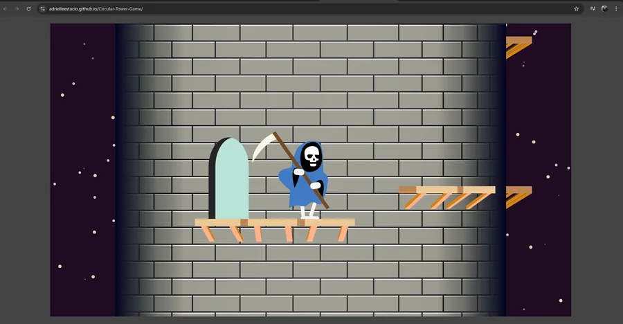

# Circular Tower Game

A browser platformer set on a round tower: the player runs left and right
around the inside of a cylinder and jumps between wooden platforms, with the
tower rotating under them instead of the camera panning. Everything renders to
a single `<canvas>` — there is no engine and no build step.

**[▶ Play it](https://adrielleestacio.github.io/Circular-Tower-Game/)**

> **Credit.** This is not my design. It is adapted from the
> **[Unruly Tower](https://codepen.io/johan-tirholm/pen/jZorRd)** pen by
> [johan-tirholm](https://codepen.io/johan-tirholm) on CodePen, including the
> sprite art, which still loads from that pen's asset host. I put it here as
> a study piece — a worked example of a canvas game loop to read and take
> apart — and deployed it to GitHub Pages.



## Controls

Left and right arrows to run, space to jump.

## Running it locally

One file, no dependencies:

```bash
git clone https://github.com/adrielleestacio/Circular-Tower-Game.git
cd Circular-Tower-Game
python -m http.server 8000
```

Then open <http://localhost:8000>. Opening `index.html` directly works too.

The sprite art is fetched from an external asset host at runtime, so the game
needs a network connection even when it is served locally.

## How it works

Everything lives in `index.html`. In rough reading order:

| Piece | What it does |
| --- | --- |
| `Point`, `OffScreenCanvas` | Small helpers. Sprites are drawn once into offscreen canvases and reused, rather than redrawn each frame. |
| `prepareGraphics`, `prepareImage` | Loads the sprite sheets and pre-renders each animation frame, including the flipped copies for facing left. |
| `drawDoor`, `drawPolygon`, `getBox` | Procedural pieces — the doorways and platform shapes are drawn in code, not loaded as art. |
| `doCalculations` | One tick of physics: acceleration, friction, a maximum speed, and gravity. |
| `collisionDetection` | Decides what the player is standing on and what stops them. |
| `draw` | The frame loop, on `requestAnimationFrame`. |
| `drawSky`, `drawPlatforms`, `drawPlayer`, `drawTitles` | The layers, drawn back to front so platforms can pass in front of the player. |
| `resize` | Scales the whole container to fit the window, so the 1600×900 canvas keeps its proportions on any screen. |

The loop records the milliseconds since the previous frame, and the jump uses
that figure to hold its arc steady when frames come in faster than every 30ms.

## Built with

Vanilla JavaScript · HTML5 Canvas · GitHub Pages

Original pen by [johan-tirholm](https://codepen.io/johan-tirholm/pen/jZorRd).
